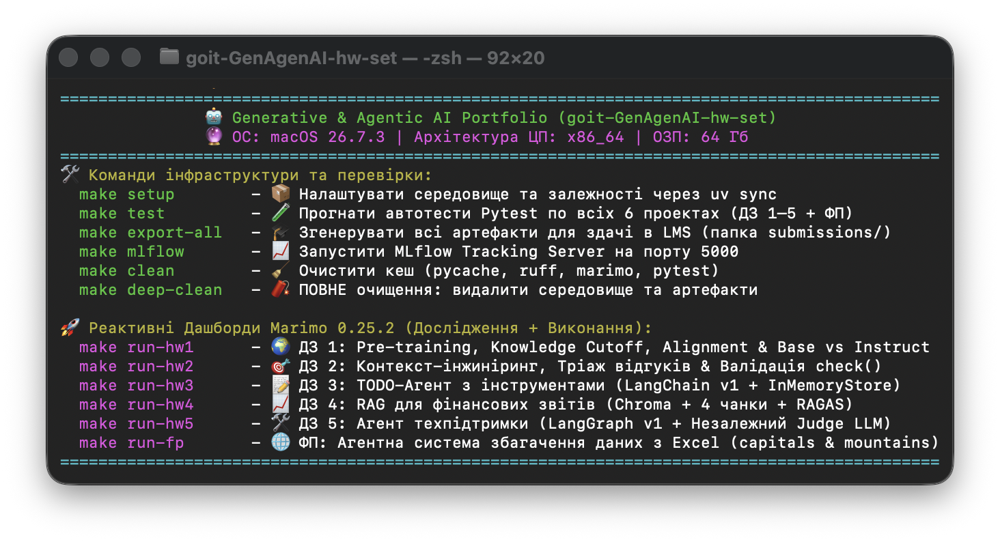

# goit-GenAgenAI-hw-set

## 🧠 Generative & Agentic AI Engineering Portfolio

[](https://opensource.org/licenses/MIT) [](https://docs.python.org/3.12/) [](https://docs.astral.sh/uv/) [](https://www.gnu.org/software/make/) [](https://marimo.io/) [](https://python.langchain.com/) [](https://langchain-ai.github.io/langgraph/)

**Студент:** Oleh Hatsenko | **Курс:** GoIT Neoversity Master of Science in CS, AI & ML

Цей репозиторій містить серію практичних інженерних домашніх робіт (ДЗ 1–5) та фінальний проект, виконані у межах магістерського курсу **"Generative and Agentic AI"** в **NeoVersity** та масштабовані до рівня production-ready монорепозиторію станом на 15 листопада 2026 року.

Роботи демонструють повний цикл проектування надійних генеративних і агентних систем: від низькорівневого аналізу токенізації, семплінгу й ціннісного вирівнювання (Alignment) великих мовних моделей до побудови детермінованих конвеєрів **Context Engineering**, антигалюцинаційних **RAG-систем**, циклічних та послідовних графів **LangGraph v1** із механізмами **Human-in-the-Loop (L4 Approver)** та багатопотокових агентних пайплайнів збагачення корпоративних даних через вебпошук.

Проект побудований на принципах **Clean Architecture**, **3-Tier Graceful Degradation** (хмарні API Gemini/OpenRouter/OpenAI ⟷ автономний локальний інференс `llama.cpp`/Ollama/MPS/CUDA ⟷ детермінований SQLite/JSON кеш) та сучасних індустріальних стандартів LLMOps. Дослідницький аналіз, трасування графів та інтерактивне тестування інтегровано через реактивне середовище **Marimo 0.25.2**.

---

## 🗂 Декомпозиція проектів монорепозиторію

Монорепозиторій складається з інфраструктурного ядра (`core/`), 5 послідовних інженерних модулів домашніх завдань та фінального мультиагентного проекту, кожен із яких супроводжується інтерактивним реактивним дашбордом у **Marimo 0.25.2** (`notebooks_eda/`) та генератором чистих артефактів для здачі (`submissions/`):

- **`hw_01_model_alignment/` — Дослідження Pre-training, Worldview Alignment та Base vs Instruct:** Кількісне та якісне порівняння моделей китайської (`Qwen3.5-14B`, `DeepSeek-V4-Thinking`) та американської (`Claude Opus 5`, `Gemini 3.1 Pro`) екосистем у трьох вимірах: вплив складу претрейн-корпусів і дати відсікання знань (Knowledge Cutoff 2025–2026) на генерацію поезії українською мовою; стійкість ціннісних настанов (Constitutional AI vs регуляції CAC КНР) при прямій, перефразованій та інвертованій полярності запитань ($Так \leftrightarrow Ні$) і тиску авторитету користувача (*Sycophancy*); фундаментальна різниця між авторегресивним продовженням $P(x_t | x_{<t})$ у `Base`-моделях та інструкційною поведінкою після етапів `SFT + DPO/RLHF` в `Instruct`-моделях. Доповнено математичним симулятором `Temperature / Top-P / Top-K` та профілювальником економіки BPE-токенізації.
- **`hw_02_context_triage/` — Контекст-інжиніринг, Тріаж Інцидентів та Суворі JSON-Контракти:** Розробка детермінованих системних промптів із XML-ізоляцією інструкцій та даних для екстракції іменованих сутностей і тональності (`person + tone`), технічного тріажу відгуків із канонічною нормалізацією назв продуктів (`Atlas Pro ➔ Atlas`, `priority`) та класифікації системних реліз-ноутів із жорстким обмеженням довжини заголовка ($\le 8$ слів). Впроваджено контур самовідновлення (`Self-Correction Retry Loop`) навколо функції `check()`, поліморфні `Union`-схеми `Pydantic v2`, почастковий стримінг `TypedDict`, маршрутизацію `RunnableBranch / RunnableParallel` та експериментальне дослідження впливу порядку ключів у JSON (`explanation-first` як прихований Chain-of-Thought).
- **`hw_03_todo_agent/` — Агент Керування Списком Справ (`LangChain v1` + `InMemoryStore`):** Побудова інструментального ReAct-агента через `create_agent` з довготривалою пам'яттю `InMemoryStore` (`get_store()`), яка зберігає стан між ізольованими сесіями діалогу. Реалізовано двокроковий протокол безпечного видалення завдань за змістом (`list_tasks ➔ пошук 8-символьного UUID ➔ store.get ➔ store.delete`), обхід дефолтного ліміту пошуку через `store.search(namespace, limit=1000)`, динамічне перемикання моделей через `@wrap_model_call`, ін'єкцію стану `InjectedState` з командами `Command` та перехоплення деструктивних дій через `HumanInTheLoopMiddleware`.
- **`hw_04_financial_rag/` — Фінансова RAG-Система з Захистом Сутностей та Оцінюванням `RAGAS`:** Індексація та семантичний пошук по фінансових звітах українських компаній за 2024 рік у векторній базі `ChromaDB` (`finansovi_zvity_kompaniy`). Забезпечено детерміноване розбиття тексту на рівно 4 логічні чанки по компаніях (`separators=["\n\n"]`, `chunk_size=300`, `chunk_overlap=0`), пошук Top-2 документів (`k=2`) та двошаровий антигалюцинаційний протокол, який нормалізує орфографічні варіації (`ТехНова Інк ≡ Технова Інк`, `Рітейл Макс Груп ≡ РітейлМакс Груп`), але жорстко блокує видачу чужого чистого прибутку на запиті про неіснуючу компанію («ЕкоПакування Солюшнс» проти «ГрінЕнерджі Солюшнс»). Розширено реалізацією `Multi-Query`, `RAG-Fusion (Reciprocal Rank Fusion, k=60)`, `Decomposition`, `Step-Back Prompting`, `HyDE` та матрицею метрик `RAGAS`.
- **`hw_05_support_langgraph/` — Агент Технічної Підтримки на `LangGraph v1` та Контур `Dual LLM-as-Judge`:** Проектування строго послідовного графа `StateGraph(SupportAgentState)` із чотирьох вузлів (`classify_query ➔ search_faq ➔ draft_response ➔ check_escalation`) з політиками `RetryPolicy(max_attempts=3)`. Впроваджено семантичну селекцію рівно 1–2 найрелевантніших пунктів FAQ, детерміноване правило ескалації в коді Python за рівнем терміновості, типом звернення та морфологічними основами ключових слів (`"шахрайств"`, `"судов"`, `"юридичн"`), суворий контроль довжини відповіді ($\le 50$ слів разом із суфіксом ескалації) та подвійну верифікацію якості через `Self-Judge` і незалежну модель-суддю (`gpt-5.6-terra` / `gemini-3.1-pro`) для усунення *Self-Enhancement Bias*. Додано R&D-контур динамічної маршрутизації через `Command[Literal[...]]`, `interrupt()` та `MemorySaver`.
- **`fp_excel_enricher/` — Фінальний Проект: Мультиагентна AI-Система Інтелектуального Збагачення Даних з Excel:** Універсальний багатопотоковий конвеєр `process_excel(file_path, task_description)`, який автоматично аналізує схему довільної таблиці Excel (`.xlsx`), формує оптимальну стратегію вебпошуку (`SchemaTaskPlanner`), паралельно виконує пошукові запити через пул потоків `ThreadPoolExecutor` (`Tavily API` + безключовий геокодер `Open-Meteo API` + `Wikipedia REST API` + локальний JSON-кеш), витягує та верифікує числові й фактологічні дані з точністю $\pm 10\%$ (`FactExtractor` + `BatchAuditor`) і зберігає відформатовані таблиці `capitals_enriched.xlsx` та `mountains_enriched.xlsx` зі 100% збереженням вхідної структури.

---

## 🛠 Ключові архітектурні рішення (Key Architectural Decisions)

Під час інженерної розробки монорепозиторію були прийняті та імплементовані такі системні рішення:

- **Трьохрівнева відмовостійка маршрутизація (`3-Tier Graceful Degradation`):** Жоден модуль не має жорсткої точки відмови на зовнішньому платному API. Усі виклики LLM, ембедингів і вебпошуку в `core/` проходять крізь три каскадні рівні: **Tier 1 (Cloud Free / Low-Cost API)** — Google Gemini (`gemini-2.5-flash` / `gemini-3.1-pro` через офіційний OpenAI-сумісний ендпоінт), OpenRouter (`openai/gpt-oss-120b`) та OpenAI (`gpt-5.6-luna`); **Tier 2 (Autonomous Local GPU/MPS)** — локальні сервери `llama.cpp` / `Ollama` / `vLLM`; **Tier 3 (Deterministic Offline Cache & Reference Engines)** — контентно-адресований SQLite/JSON кеш та кастомні детерміновані спадкоємці `BaseChatModel` і `Embeddings`, які дозволяють проганяти повний цикл автотестів `pytest` за мілісекунди в 100% офлайн-середовищі.
- **Автоматична актуалізація моделей та параметрів інференсу (Стандарт 15.11.2026):** Маршрутизатор `core/llm_router.py` автоматично перехоплює вимкнені у 2026 році моделі (`gpt-4`, `gpt-3.5-turbo`, `claude-opus-4-1-20250805`), прозоро замінює їх на актуальні флагмани (`gpt-5.6-luna`, `claude-opus-5-5`, `openai/gpt-oss-120b`), автоматично видаляє несумісний параметр `temperature` для міркувальних (reasoning) моделей сімейства `gpt-5` і виконує фолбек ролі повідомлення `developer ➔ system`, якщо обраний провайдер не підтримує роль `developer`.
- **Двокроковий Stateless-протокол роботи з `InMemoryStore` (ДЗ 3):** Оскільки в агентних тестах кожен запит користувача надходить у новій сесії без історії попередніх повідомлень, системний промпт та описи інструментів примусово зобов'язують агента перед будь-яким видаленням за змістом («Видали завдання про хліб») спершу викликати `list_tasks()` (з `limit=1000`), витягнути точний 8-символьний `uuid4` та перевірити наявність запису через `store.get()` перед викликом `store.delete()`.
- **Орфографічно-стійкий Entity Guardrail у RAG проти галюцинацій при $k=2$ (ДЗ 4):** Ретрівер векторної бази з `k=2` завжди повертає два чанки, навіть коли запитуваної компанії немає в базі (через спільне слово «Солюшнс» запит про «ЕкоПакування Солюшнс» підтягує чанк «ГрінЕнерджі Солюшнс» із прибутком 156 млн дол). Впроваджений двофазний верифікатор у промпті та парсері одночасно ігнорує несуттєві орфографічні відмінності в назвах існуючих компаній (`ТехНова Інк ≡ Технова Інк`, `Рітейл Макс Груп ≡ РітейлМакс Груп`), але блокує підстановку цифр при розбіжності кореневої назви сутності.
- **Усунення Self-Enhancement Bias через Dual LLM-as-Judge та захищений Regex-парсер (ДЗ 5):** Коли та сама LLM генерує відповідь і сама ж себе оцінює, виникає систематичне завищення метрики `Answer Relevancy`. Система розділяє генератор (`role="worker"`) і ревізора (`role="judge"`), а парсер `parse_relevancy_score` коректно обробляє десяткові коми (`0,9 ➔ 0.9`), знаки відсотків (`85% ➔ 0.85`), 10-бальні шкали та крапки в кінці речення (`0.85. ➔ 0.85`), на яких падав базовий шаблон.
- **Подвійний геодезичний коридор валідації ($\pm 10\%$) та гібридний вебпошук (Фінальний проект):** Для задачі пошуку відстаней між містами (`capitals.xlsx`) та висоти гір (`mountains.xlsx`) поєднано пошуковий рушій `Tavily API` з безключовим геокодером `Open-Meteo API`, `Wikipedia REST API` та формулою Гаверсинуса (great-circle distance), що забезпечує нульові витрати пошукових кредитів при повторних запусках і масштабування на таблиці до 1000+ рядків.

---

## 🛠 Технологічний Стек (Bleeding Edge — Листопад 2026)

У проекті використовуються строго узгоджені версії бібліотек (PEP 621), які гарантують стабільність виконання на ефемерних хмарних сесіях (Google Colab) та локальних робочих станціях з архітектурою Apple Silicon / x64:

### 🤖 Agentic & LLM Orchestration Frameworks

- [](https://pypi.org/project/langchain/) 🔸 Фундаментальний фреймворк оркестрації v1 (`create_agent`, `HumanInTheLoopMiddleware`, `@wrap_model_call`, `InjectedState`).
- [](https://pypi.org/project/langgraph/) 🔸 Циклічні та послідовні графи станів (`StateGraph`, `Command`, `RetryPolicy`, `interrupt`, `InMemoryStore`, `MemorySaver`).
- [](https://pypi.org/project/langchain-core/) 🔸 Декларативна мова LCEL (`RunnableParallel`, `RunnableBranch`, `RunnablePassthrough`, `StrOutputParser`).
- [](https://pypi.org/project/chromadb/) 🔸 Векторне сховище (`langchain-chroma`) для семантичного та гібридного RAG-пошуку (`RAG-Fusion / RRF`, `HyDE`, `Step-Back`).
- [](https://pypi.org/project/pydantic/) 🔸 Сувора валідація JSON-контрактів, `Union`-схем та `.with_structured_output()`.

### 🎨 Reactive EDA & UI Frameworks

- [](https://pypi.org/project/marimo/) 🔸 Реактивне Python-середовище нового покоління з підтримкою нативного рендерингу графів `mo.mermaid()`, інтерактивних слайдерів і таблиць та експорту в самодостатній HTML і Jupyter `.ipynb`.
- [](https://pypi.org/project/plotly/) 🔸 Інтерактивні теплові карти косинусної схожості ембедингів, профілювання розподілів семплінгу, токенізації та метрик RAGAS.

### 💾 Data Engineering & Web Search

- [](https://pypi.org/project/polars/) 🔸 Надшвидкий рушій обробки табличних даних і телеметрії (Rust).
- [](https://pypi.org/project/openpyxl/) 🔸 Читання, запис і автоматичне форматування таблиць Excel (`.xlsx`) для агентної системи збагачення даних.
- [](https://pypi.org/project/langchain-tavily/) 🔸 Спеціалізований пошуковий рушій для LLM-агентів у комбінації з `Open-Meteo Geocoding API`, `Wikipedia REST API` та локальним JSON/SQLite кешем.

### ⚙️ LLMOps, Tracing & Quality Assurance

- [](https://smith.langchain.com/) 🔸 Інспектування кроків ReAct-агентів, вартості токенів та латентності зі скиданням кешу змінних середовища на льоту (`ls_utils.get_env_var.cache_clear()`).
- [](https://pypi.org/project/mlflow/) 🔸 Локальне логування метрик експериментів (`TCR`, `Answer Relevancy`, `Escalation Rate`, `RAGAS`).
- [](https://pypi.org/project/pytest/) 🔸 Автоматизована перевірка всіх критеріїв прийняття ДЗ 1–5 та Фінального проекту.

---

## 📂 Архітектура та проекти

```text
goit-GenAgenAI-hw-set/
│
├── .venv/                         # 🐍 Ізольоване віртуальне середовище (генерується автоматично через uv)
│
├── core/                          # ⚙️ 3-Tier LLMOps & Agentic Ядро (Спільна інфраструктура для всіх проектів)
│   ├── __init__.py                # 🧠 Ініціалізація ядра, зчитування .env, налаштування логерів та фасад API
│   ├── datasets.py                # 🗃️ SmartReader (Polars/Pandas + OpenPyXL автоформатування таблиць Excel)
│   ├── embeddings_router.py       # 🧬 SmartEmbeddingsRouter (3-Tier: Cloud Embeddings ➔ Local HF ➔ Deterministic L2)
│   ├── eval_core.py               # 📐 Універсальне ядро валідації (check(), robust_invoke, Dual Judge, RAGAS, MLflow)
│   ├── hardware.py                # 🔌 Маршрутизатор обчислень (CUDA/ROCm/MPS/CPU), фіксація GLOBAL_SEED та VRAM
│   ├── llm_router.py              # 🛡️ SmartLLMRouter (3-Tier: Gemini/OpenRouter/OpenAI ➔ Local llama.cpp ➔ SQLite Cache)
│   └── search_router.py           # 🌐 SmartSearchRouter (3-Tier: Tavily/Serper ➔ Open-Meteo/Wikipedia/Haversine ➔ Cache)
│
├── data/                          # 💾 Директорія даних та персистентних кешів
│   ├── cache/                     # ⚡ Детермінований SQLite/JSON кеш відповідей LLM та пошукових сніпетів
│   │   ├── llm_cache.sqlite       # 🗄️ Локальна SQLite-база кешованих відповідей моделей (SHA-256)
│   │   └── web_search_cache.json  # 🌐 Кеш результатів пошукових запитів Tavily / Open-Meteo / Wikipedia
│   ├── hw_fp_excel/               # 📑 Еталонні вхідні таблиці для Фінального проекту
│   │   ├── capitals.xlsx          # 🌍 Тестовий набір 1: Маршрути між столицями (10 рядків)
│   │   ├── mountains.xlsx         # 🏔️ Тестовий набір 2: Вершини Гімалаїв та Каракоруму (10 рядків)
│   │   └── mountains_pdf.xlsx     # ⛰️ Додатковий набір із тексту PDF (Everest, Mont Blanc, Denali, Kilimanjaro)
│   └── .gitkeep                   # ⚠️ Маркер збереження директорії у системі контролю версій Git
│
├── notebooks_eda/                 # 📊 Інтерактивні реактивні дашборди Marimo 0.25.2 (Дослідження + Виконання)
│   ├── hw_01_eda.py               # 🌍 ДЗ 1: Pre-training, Knowledge Cutoff, Alignment (Так↔Ні) & Base vs Instruct
│   ├── hw_02_eda.py               # 🎯 ДЗ 2: Context Engineering, JSON Triage, check() & LCEL RunnableBranch
│   ├── hw_03_eda.py               # 📝 ДЗ 3: LangChain v1 TODO-Агент з InMemoryStore та HITL Middleware
│   ├── hw_04_eda.py               # 📈 ДЗ 4: Financial RAG (Chroma + 4 чанки + k=2 + RAG-Fusion/HyDE + RAGAS)
│   ├── hw_05_eda.py               # 🛠️ ДЗ 5: LangGraph v1 Support Agent + Mermaid-граф + Dual LLM-as-Judge
│   └── fp_eda.py                  # 🌐 ФП: Агентне збагачення Excel-даних (ThreadPoolExecutor + Tavily + Geodesic)
│
├── hw_01_model_alignment/         # 🌍 Проект 1: Порівняння претрейну, картин світу (Alignment) та Base vs Instruct
│   ├── __init__.py                # 📦 Експорт класів та промптів модуля ДЗ 1
│   ├── benchmark.py               # 🔬 Верифікатор віршів (6 рядків), матриці полярності Так↔Ні, семплінгу й токенізації
│   ├── prompts.py                 # 💬 Еталонні промпти для Arena.ai та OpenRouter (включно з тестами Sycophancy)
│   ├── report_builder.py          # 📄 Автогенератор звіту для Google Docs (Hatsenko_Oleh_DZ1.md) та ноутбука .ipynb
│   └── ui_labels.py               # 🌐 Локалізація елементів інтерфейсу для Marimo
│
├── hw_02_context_triage/          # 🎯 Проект 2: Контекст-інжиніринг, класифікація та суворий JSON-парсинг
│   ├── __init__.py                # 📦 Експорт екстракторів, схем та LCEL-компонентів ДЗ 2
│   ├── corpora.py                 # 🗃️ Канонічні корпуси завдань 1–3 (15 текстів) та R&D стрес-корпус із сарказмом
│   ├── extractor.py               # ⚙️ 3-Tier екстрактор із фолбеком developer➔system та Self-Correction Loop
│   ├── lcel_structured.py         # 🔗 Маршрутизація RunnableBranch, RunnableParallel, Union-схеми та TypedDict Stream
│   ├── prompts.py                 # 💬 Системні промпти з XML-розміткою та дослідження порядку ключів у JSON
│   ├── schemas.py                 # 🛡️ Канонічна функція check() та суворі моделі Pydantic v2
│   └── ui_labels.py               # 🌐 Локалізація елементів інтерфейсу для Marimo
│
├── hw_03_todo_agent/              # 📝 Проект 3: Агент керування списком справ (LangChain v1 + InMemoryStore)
│   ├── __init__.py                # 📦 Експорт інструментів, фабрики агента та HITL-розширень ДЗ 3
│   ├── agent.py                   # 🤖 Фабрика create_agent, детермінований ReAct-рушій та логування траєкторії
│   ├── middleware_hitl.py         # ⏸️ Розширення: HumanInTheLoopMiddleware, @wrap_model_call, InjectedState, Command
│   ├── prompts.py                 # 💬 Системний промпт українською (двокроковий протокол видалення через list_tasks)
│   ├── store_tools.py             # 🔧 Інструменти add_task, list_tasks (limit=1000), delete_task (store.get ➔ delete)
│   └── ui_labels.py               # 🌐 Локалізація елементів інтерфейсу для Marimo
│
├── hw_04_financial_rag/           # 📈 Проект 4: RAG-система аналізу фінансових звітів українських компаній
│   ├── __init__.py                # 📦 Експорт сплітера, векторного сховища та RAG-ланцюга ДЗ 4
│   ├── advanced_rag.py            # 🚀 Трансформації запитів: Multi-Query, RAG-Fusion (RRF), Decomposition, Step-Back, HyDE
│   ├── chunker.py                 # ✂️ Сплітер RecursiveCharacterTextSplitter (separators=["\n\n"], рівно 4 чанки)
│   ├── prompts.py                 # 💬 Антигалюцинаційний промпт із захистом від підміни «ЕкоПакування Солюшнс»
│   ├── rag_chain.py               # 🔗 LCEL RAG-ланцюг, оцінювання за 4 метриками RAGAS та експорт ноутбуків
│   ├── ui_labels.py               # 🌐 Локалізація елементів інтерфейсу для Marimo
│   └── vector_store.py            # 🗄️ Векторне сховище Chroma (finansovi_zvity_kompaniy, k=2) та матриця косинусів
│
├── hw_05_support_langgraph/       # 🛠️ Проект 5: Агент технічної підтримки на LangGraph v1
│   ├── __init__.py                # 📦 Експорт станів, вузлів, графа та модуля оцінювання ДЗ 5
│   ├── advanced_hitl_graph.py     # 🚦 Розширення Теми 9: маршрутизація Command[Literal[...]], interrupt() та MemorySaver
│   ├── evaluator.py               # ⚖️ Виправлений calculate_answer_relevancy, Dual Judge, test_agent() та експорт
│   ├── graph.py                   # 🕸️ Компіляція строго послідовного StateGraph (build_support_agent) із RetryPolicy
│   ├── nodes.py                   # 🔄 4 вузли: classify_query ➔ search_faq (1-2 п.) ➔ draft_response ➔ check_escalation
│   ├── prompts.py                 # 💬 База знань FAQ_DATABASE та промпти класифікації терміновості й генерації (≤50 слів)
│   ├── state.py                   # 📋 Типи даних QueryClassification та SupportAgentState
│   └── ui_labels.py               # 🌐 Локалізація елементів інтерфейсу для Marimo
│
├── fp_excel_enricher/             # 🌐 Фінальний Проект: Інтелектуальне збагачення Excel-даних через вебпошук
│   ├── __init__.py                # 📦 Експорт публічного фасаду process_excel() та агентних компонентів
│   ├── enricher_graph.py          # ⚡ Оркестратор LangGraph + ThreadPoolExecutor + подвійний коридор валідації ±10%
│   ├── excel_io.py                # 📊 Безпечне читання/запис Excel та генерація еталонних вхідних таблиць
│   ├── prompts.py                 # 💬 Промпти планування пошукової стратегії, екстракції фактів та пакетного аудиту
│   ├── query_planner.py           # 🧠 Агент SchemaTaskPlanner (універсальний аналіз колонок без зміни коду)
│   ├── search_engine.py           # 🔍 Пошуковий рушій (Tavily API + Open-Meteo Geocoding + Wikipedia + JSON Cache)
│   └── ui_labels.py               # 🌐 Локалізація елементів інтерфейсу для Marimo
│
├── submissions/                   # 🎓 Готові артефакти для здачі в LMS (.ipynb, .html, _enriched.xlsx, .md)
│   ├── Hatsenko_Oleh_DZ1.md       # 📄 Готовий структурований звіт ДЗ 1 для Google Docs
│   ├── oleh_hatsenko_hw1.ipynb    # 📓 Відтворюваний ноутбук ДЗ 1
│   ├── oleh_hatsenko_hw2.ipynb    # 📓 Чистий ноутбук ДЗ 2 (3 комірки завдань + check() + get_secret())
│   ├── oleh_hatsenko_hw3.ipynb    # 📓 Чистий ноутбук ДЗ 3 (TODO-агент на create_agent + InMemoryStore)
│   ├── oleh_hatsenko_hw4.ipynb    # 📓 Чистий ноутбук ДЗ 4 / Oleh_Hatsenko_DZ7.ipynb (Фінансовий RAG на Chroma)
│   ├── oleh_hatsenko_hw5.ipynb    # 📓 Чистий ноутбук ДЗ 5 / Oleh_Hatsenko_DZ9.ipynb (Агент техпідтримки LangGraph)
│   ├── oleh_hatsenko_fp.ipynb     # 📓 Чистий ноутбук Фінального проекту (process_excel)
│   ├── capitals_enriched.xlsx     # 🌍 Збагачена таблиця 1: Столиці з заповненою колонкою distance (км)
│   ├── mountains_enriched.xlsx    # 🏔️ Збагачена таблиця 2: Гори з заповненою колонкою height (м)
│   └── .gitkeep                   # ⚠️ Маркер збереження директорії у системі контролю версій Git
│
├── tests/                         # 🧪 Набір автотестів Pytest для верифікації всіх критеріїв оцінювання (100/100)
│   └── test_all_submissions.py    # ✅ Наскрізне тестування ДЗ 1–5 та Фінального проекту
│
├── mlruns/                        # 📊 База даних MLflow Tracking (історія запусків, метрик та спанів)
│   └── .gitkeep                   # ⚠️ Маркер збереження директорії у системі контролю версій Git
│
├── models/                        # 📦 Директорія збережених локальних артефактів та конфігурацій схем
│   └── .gitkeep                   # ⚠️ Маркер збереження директорії у системі контролю версій Git
│
├── .editorconfig                  # 📝 Стандарти форматування коду для VS Code / Cursor / VSCodium
├── .env                           # 🔐 Локальні змінні середовища (ключі API, конфіги — ігнорується Git)
├── .env.example                   # 📄 Безпечний шаблон змінних середовища для розгортання на нових машинах
├── .gitignore                     # 🚫 Правила ігнорування секретів, кешів і тимчасових артефактів
├── LICENSE                        # ⚖️ Ліцензія відкритого вихідного коду (MIT)
├── Makefile                       # 🪄 Zero-Config оркестратор проекту: єдина точка входу
├── pyproject.toml                 # 📦 Сучасний стандарт опису метаданих та залежностей (PEP 621)
├── README.md                      # 📖 Головна архітектурна документація проекту
└── uv.lock                        # 🔒 Суворий лок-файл крос-платформних залежностей
```

---

## 📚 Використані методології та патерни ШІ-інженерії

- **Парадигми промптингу та Context Engineering:** Zero-Shot / Few-Shot In-Context Learning, Chain-of-Thought (CoT), Hidden Reasoning-First JSON Structuring, Step-Back Prompting, Least-to-Most Decomposition та XML Role/Data Isolation.
- **Когнітивні та агентні архітектури:** Цикл ReAct (Reason + Act), детерміновані графи станів (`StateGraph`), ієрархічна координація субагентів (`SchemaTaskPlanner ➔ Parallel Workers ➔ BatchAuditor`) та рівні автономності агентів від **L1 (Simple Processor)** до **L4 (User as an Approver / Human-in-the-Loop)**.
- **Просунутий інформаційний пошук (Advanced RAG):** Семантичне чанкування з контролем меж сутностей, Multi-Query Expansion, **RAG-Fusion (Reciprocal Rank Fusion — RRF)**, **HyDE (Hypothetical Document Embeddings)** та строга верифікація сутностей (Entity Guardrails).
- **Оцінювання якості та надійності (LLMOps & Evals):** Тріада метрик **RAGAS** (*Faithfulness*, *Answer Relevancy*, *Context Precision*, *Context Recall*), агентні метрики (*Task Completion Rate*, *Escalation Rate*, *Tool Calling Trajectory*), патерн **Dual LLM-as-Judge** (боротьба із *Self-Enhancement Bias*) та тестування на *Sycophancy* і *Polarity Inversion*.
- **Стандарти взаємодії та регуляції ШІ:** Принципи **MCP (Model Context Protocol)** для інтеграції інструментів ($N \times M \rightarrow N + M$), **A2A / ACP** для міжагентної комунікації, **Constitutional AI** та ризик-орієнтована класифікація за **EU AI Act**.

---

## 🪬 Швидкий старт

Проект має **Zero-Config Boot**. Достатньо мати встановлений Python 3.12+ та утиліту GNU Make.



Щоб побачити повний список команд інфраструктури, виконайте у терміналі:

```bash
make
```

```bash
make setup        # Створити ізольоване середовище .venv та синхронізувати пакети через uv
make test         # Прогнати автотести Pytest по всіх 6 проектах (ДЗ 1–5 + Фінальний проект)
make export-all   # Згенерувати всі чисті .ipynb, .html, .md та _enriched.xlsx у папку submissions/
make run-hw1      # Запустити реактивний дашборд ДЗ 1 (Pre-training, Alignment & Sampling)
make run-hw2      # Запустити реактивний дашборд ДЗ 2 (Context Engineering & JSON Triage)
make run-hw3      # Запустити реактивний дашборд ДЗ 3 (LangChain v1 TODO-Агент + InMemoryStore)
make run-hw4      # Запустити реактивний дашборд ДЗ 4 (Financial RAG + ChromaDB + RAGAS)
make run-hw5      # Запустити реактивний дашборд ДЗ 5 (LangGraph Support Agent + Dual Judge)
make run-fp       # Запустити реактивний дашборд Фінального проекту (Excel Data Enricher)
make mlflow       # Запустити сервер візуалізації експериментів MLflow на порту 5000
```

> **Приклад типового пайплайну:**
> 1. `make setup` (створить ізольоване середовище `.venv` та встановить `LangChain 1.4+` / `LangGraph 1.2+` / `Marimo 0.25.2`).
> 2. `make test` (перевірить 100% критеріїв прийняття всіх 5 домашніх робіт та фінального проекту).
> 3. `make export-all` (автоматично згенерує всі готові ноутбуки `.ipynb`, інтерактивні звіти `.html` та таблиці `capitals_enriched.xlsx` / `mountains_enriched.xlsx` у директорію `submissions/`).

---

## 💝 Контакти

Якщо цей репозиторій здався вам цікавим, і ви шукаєте інженера / архітектора, який здатен проектувати надійні мультиагентні AI-системи, об'єктно-орієнтовані ML/DL пайплайни та відмовостійкі архітектури виробничого рівня — буду радий поспілкуватися!

- **LinkedIn:** [IRONKAGE](https://www.linkedin.com/in/ironkage)
